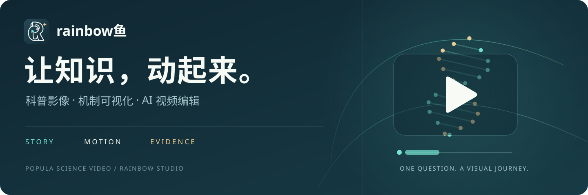
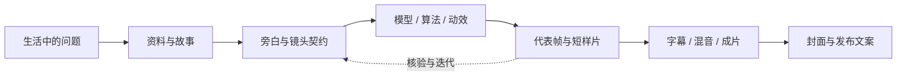

<div align="center">



# Popula_science_video

**把一个好问题，讲成一段看得懂的旅程。**

rainbow鱼的科普视频工程库 · 机制可视化 · 连续运镜 · AI 视频编辑

[开始使用](docs/QUICKSTART.md) · [工程目录](docs/PROJECTS.md) · [文件规范](docs/PROJECT_STRUCTURE.md) · [素材与恢复](docs/ASSETS.md) · [协作流程](docs/CONTRIBUTING.md)

</div>

---

这里保存从故事、讲稿、算法与模型，到镜头、字幕、封面和发布文案的制作源码，以及用于持续迭代这些作品的 **rainbow鱼 AI 视频编辑器**。仓库独立整理自原有创作工作区，保留各项目的真实入口和历史路径；本次范围不包含 `ai_evolution_*` / `ai_revolution*` 系列及其 `publication_2026-09-23` 发布包。

## 从哪里开始

| 你想做什么 | 从这里进入 |
|---|---|
| 找到某一期的源码、讲稿、封面 | [工程总览](docs/PROJECTS.md)，再读该项目 `README.md` 与 `project.json` |
| 打开编辑器，预览与修改现有作品 | [五分钟启动](docs/QUICKSTART.md#启动视频编辑器) |
| 重新制作一段动画 | [渲染前的准备](docs/QUICKSTART.md#准备一个视频工程) |
| 添加一期并保持系列风格 | [目录与命名规范](docs/PROJECT_STRUCTURE.md) |
| 找成片、配音、模型与授权记录 | [素材分层与恢复](docs/ASSETS.md) |


## 作品方向

| 方向 | 代表工程 | 画面背后的问题 |
|---|---|---|
| 计算与信息 | [DNA 存储](video_project/dna_storage_algorithms/) · [密码学](video_project/cryptography_key_exchange/) · [C 指针](video_project/c_pointers/) | 文件怎样写进分子？两个人怎样建立秘密？程序怎样找到一块内存？ |
| 工程与自然 | [拓扑优化 / 榫卯等](video_project/topology_optimization/) · [彩虹](video_project/rainbow_arc_2026/) · [上海中心](video_project/shanghai_tower/) | 材料为什么可以挖空？结构怎样传力？光怎样成为一条弧？ |
| 身体与调节 | [GLP-1 与身体调节](video_project/glp1_nobel_2026/) | 一顿饭之后，血糖、血压、血脂与体重怎样相互影响？ |
| 科研与专题 | [物理学专题](video_project/nobel_physics_2026/) · [化学专题](video_project/nobel_chemistry_2026/) · [大模型幻觉](video_project/llm_hallucination/) | 怎样把论文、公式和研究假设变成可读的动态画面？ |
| 互动与实验 | [CS2 C4](video_project/cs2_c4/) · [数学演示](video_project/math_demos/) · [海洋科普](video_project/zju_marine_ep01/) | 从一个具体场景出发，让观众看见过程。 |

完整清单与各项目实际入口见 [工程总览](docs/PROJECTS.md)。历史目录里可能包含多个专题；当前可用版本应以项目导航与实际文件为准，不能只按文件夹名中的版本号判断。

## 视频编辑器

[下载 Windows 便携版（EXE + 可刷新源码）](https://github.com/rainbowyuyu/Popula_science_video/releases/download/library-2026-10-17/RainbowVideoEditor-Windows.zip) · [源码启动](docs/QUICKSTART.md)


[**creator_workbench**](video_project/creator_workbench/) 是本地运行的创作工作台，连接视频工程、模型协作与可检查的交付物。

- **一起创作**：GPT 与 Claude 共享工程上下文，按具体问题互补实现与复核；保存任务进度与实际工具结果。
- **边看边标**：在成片上选段、逐帧、标记文字和遮挡位置，再把修改清单统一交给主智能体。
- **系列一致**：管理系列封面规范、四种画幅、可编辑图层与各平台文案。
- **声音与镜头**：组织个人 TTS、字幕、BGM、镜头预设和生成素材任务。
- **从参考中学习**：独立学习工作室读取视频片段，制作样片、复核结果，再保存可复用规则。

工作台界面和外部业务代码可通过刷新加载更新；普通创作迭代不需要重编 EXE。修改启动器、内嵌图标或底层打包依赖时才涉及重新构建。画面上的即时预演不等于已经改写 MP4，成片改动仍需修改源工程并渲染。

## 一条完整的制作链



以观众能理解的机制为主线：少量大字帮助定位，运动解释关系，镜头负责连接尺度。公式、来源与教学数据保留可核对记录；艺术化演示与真实测量在项目中分别说明。

## 仓库结构

```text
Popula_science_video/
├─ README.md
├─ docs/                         总览、启动、素材与协作指引
├─ video_project/
│  ├─ creator_workbench/         AI 视频编辑器源码、界面、技能与测试
│  ├─ dna_storage_algorithms/    每期的稳定目录
│  ├─ cryptography_key_exchange/
│  ├─ ...
│  └─ shared/                    多项目共享的源码或规范
├─ yty_manim/                    共用 Manim 动画组件
├─ tools/                        仓库整理、检查与素材管理工具
└─ requirements.txt             共用 Python 依赖入口
```

每个工程提供统一导航，同时兼容既有 `src/`、`public/`、`v1/`、`v3/`、`delivery/` 等路径，不靠强制移动源码来获得整齐的表面结构。详见 [文件规范](docs/PROJECT_STRUCTURE.md)。

## 素材与可复现范围

Git 保存源码、配置示例、文稿、台账和适合入库的小型素材。选定的最新成片通过私有 [媒体归档 Release](https://github.com/rainbowyuyu/Popula_science_video/releases/tag/library-2026-10-17) 单独管理；可下载的文件以实际发布附件和各工程 `assets.manifest.json` 为准。中间渲染、依赖目录、个人音色模型、运行会话与凭据不进入代码历史。使用 `tools/assets.py` 查询与恢复媒体，见 [素材指引](docs/ASSETS.md)。

**克隆源码不代表所有旧作品可以立刻完整渲染。** 一些工程依赖本机 TTS、授权音乐、字体、模型、共享依赖或 Windows 路径；先恢复所需素材、检查来源与入口，再生成代表帧。上游模型接口与外部工具是否可用，需要在使用时检查。

## 权利与引用

rainbow鱼 Logo 与品牌资产保留原有归属。第三方论文页、插图、音频、模型、字体与工具遵循各自的授权及署名要求；来源记录不等于再分发授权。本仓库的私有可见性也不会改变第三方素材的权利状态。原 Manim 工程的 Apache-2.0 授权记录单独保留，没有以一份总许可证替所有素材授予新的使用权。详见 [权利与引用](docs/RIGHTS.md)；换机器制作前请查 [可移植性清单](docs/PORTABILITY.md)。

<div align="center">

**rainbow鱼** · 用故事引入，用画面解释，用证据收束。

</div>
