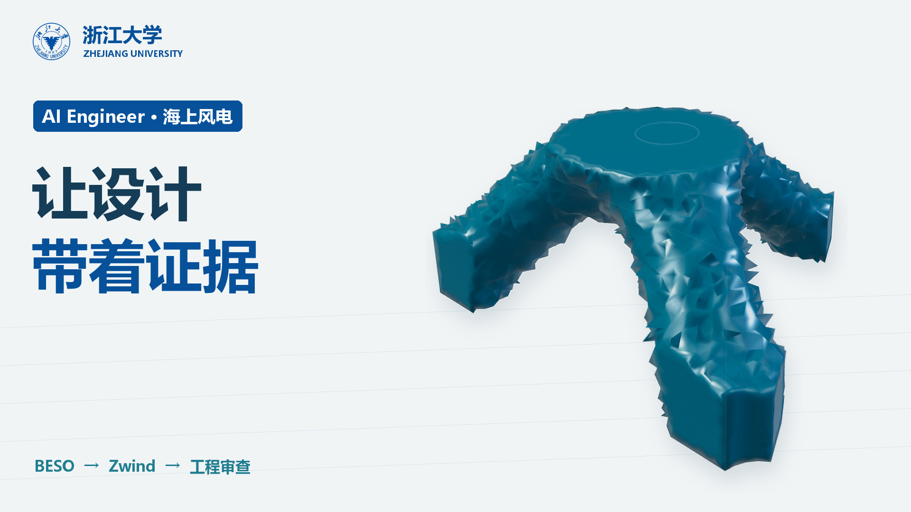

# BESO 与 AI Engineer

[← 工程总览](../../docs/PROJECTS.md) · [统一结构](../../docs/PROJECT_STRUCTURE.md) · [素材与成片](../../docs/ASSETS.md)

README 的 V6 首段已过时；V20 成片与源码实际存在。完整科研片与发布片是不同作品，均保留。



## 从哪里开始

| 内容 | 入口 |
| :--- | :--- |
| 工程元信息 | [project.json](project.json) |
| 素材与成片清单 | [assets.manifest.json](assets.manifest.json) |
| 源码入口 | [src/index-beso.tsx](src/index-beso.tsx) |
| 源码入口 | [src/index-launch-v20.tsx](src/index-launch-v20.tsx) |
| 源码入口 | [scripts/render_launch_v20.mjs](scripts/render_launch_v20.mjs) |
| 原制作说明 | [README.legacy.md](README.legacy.md) |

## 使用方式

### `.`

```powershell
cd video_project/beso_ai_research_2026
npm ci
```

可用命令：`npm run studio`、`npm run build`、`npm run preview`、`npm run typecheck`、`npm run render`、`npm run qa`。

### `tmp/launch-v17-source-6ebd624f89db`

```powershell
cd video_project/beso_ai_research_2026/tmp/launch-v17-source-6ebd624f89db
npm ci
```

可用命令：`npm run studio`、`npm run build`、`npm run preview`、`npm run typecheck`、`npm run render`、`npm run qa`。

### `tmp/launch-v18-source-e4457747837c`

```powershell
cd video_project/beso_ai_research_2026/tmp/launch-v18-source-e4457747837c
npm ci
```

可用命令：`npm run studio`、`npm run build`、`npm run preview`、`npm run typecheck`、`npm run render`、`npm run qa`。

### `tmp/launch-v19-source-8357d3bf679e`

```powershell
cd video_project/beso_ai_research_2026/tmp/launch-v19-source-8357d3bf679e
npm ci
```

可用命令：`npm run studio`、`npm run build`、`npm run preview`、`npm run typecheck`、`npm run render`、`npm run qa`。

### `work/render-v20/launch-v20-source-17b200e62bde`

```powershell
cd video_project/beso_ai_research_2026/work/render-v20/launch-v20-source-17b200e62bde
npm ci
```

可用命令：`npm run studio`、`npm run build`、`npm run preview`、`npm run typecheck`、`npm run render`、`npm run qa`。

### `work/render-v20/launch-v20-source-2afc39fce9ba`

```powershell
cd video_project/beso_ai_research_2026/work/render-v20/launch-v20-source-2afc39fce9ba
npm ci
```

可用命令：`npm run studio`、`npm run build`、`npm run preview`、`npm run typecheck`、`npm run render`、`npm run qa`。

首次渲染前，在仓库根目录运行：

```powershell
python tools/assets.py check --project "beso_ai_research_2026"
python tools/assets.py download --project "beso_ai_research_2026"
```

`download` 仅恢复已发布的成片，渲染使用的本地素材通过 `restore --source-root <原仓库>` 恢复；不包括商业插件、音色参考、API 凭据与字体。部分历史脚本保留本机路径，请参照 [可移植性清单](../../docs/PORTABILITY.md) 配置后使用。
