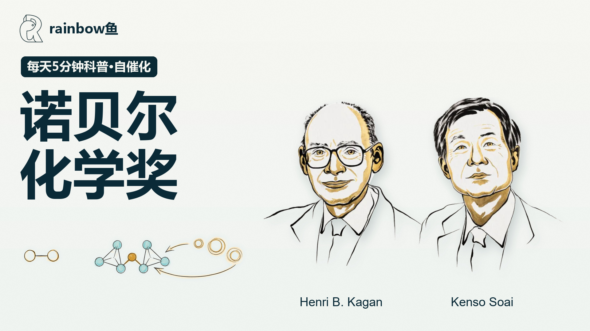

# 诺贝尔化学奖：让化学选择同一只手

[← 工程总览](../../docs/PROJECTS.md) · [统一结构](../../docs/PROJECT_STRUCTURE.md) · [素材与成片](../../docs/ASSETS.md)

V04 是 Rap 变体；保留 V03 科学内容和依赖；外部 TTS 路径需作为可配置依赖。



## 从哪里开始

| 内容 | 入口 |
| :--- | :--- |
| 工程元信息 | [project.json](project.json) |
| 素材与成片清单 | [assets.manifest.json](assets.manifest.json) |
| 源码入口 | [src/index-chemistry2026-v03.tsx](src/index-chemistry2026-v03.tsx) |
| 源码入口 | [src/index-chemistry2026-v04.tsx](src/index-chemistry2026-v04.tsx) |
| 源码入口 | [scripts/render_chemistry2026_v04_rap.mjs](scripts/render_chemistry2026_v04_rap.mjs) |
| 原制作说明 | [README.legacy.md](README.legacy.md) |

## 使用方式

### `.`

```powershell
cd video_project/nobel_chemistry_2026
npm ci
```

可用命令：`npm run check`、`npm run audio`、`npm run render`、`npm run stills`、`npm run audio:v02`、`npm run audio:v03`、`npm run render:v02`、`npm run stills:v02`、`npm run qa:v02`、`npm run render:v03`、`npm run stills:v03`、`npm run qa:v03`、`npm run audio:v04:rap`、`npm run render:v04:rap`、`npm run stills:v04:rap`、`npm run qa:v04:rap`。

首次渲染前，在仓库根目录运行：

```powershell
python tools/assets.py check --project "nobel_chemistry_2026"
python tools/assets.py download --project "nobel_chemistry_2026"
```

`download` 仅恢复已发布的成片，渲染使用的本地素材通过 `restore --source-root <原仓库>` 恢复；不包括商业插件、音色参考、API 凭据与字体。部分历史脚本保留本机路径，请参照 [可移植性清单](../../docs/PORTABILITY.md) 配置后使用。
